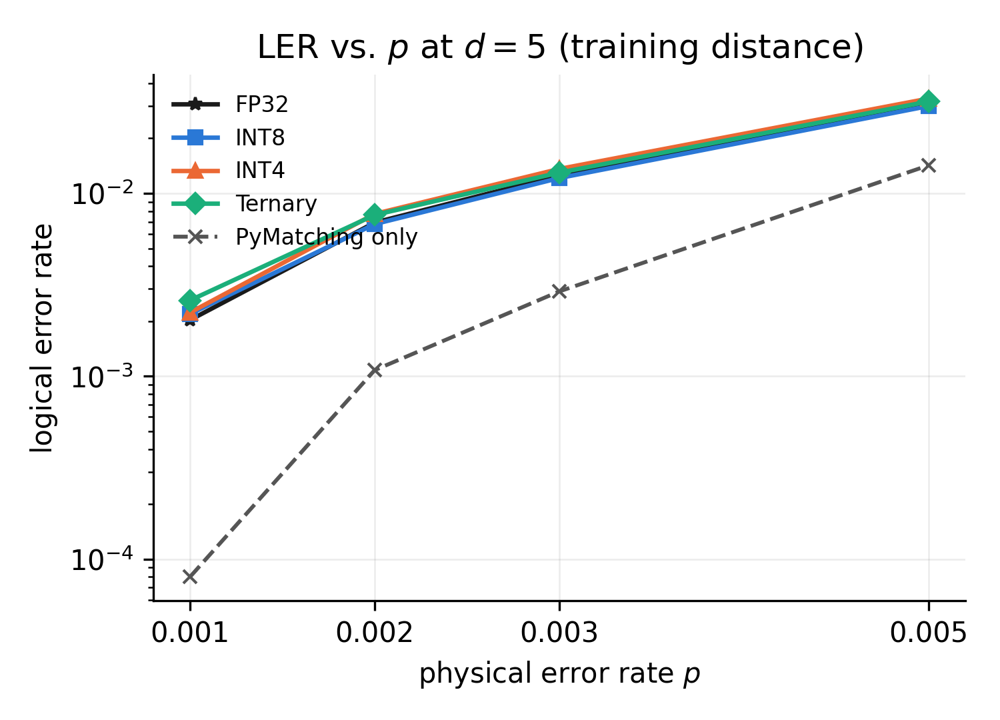
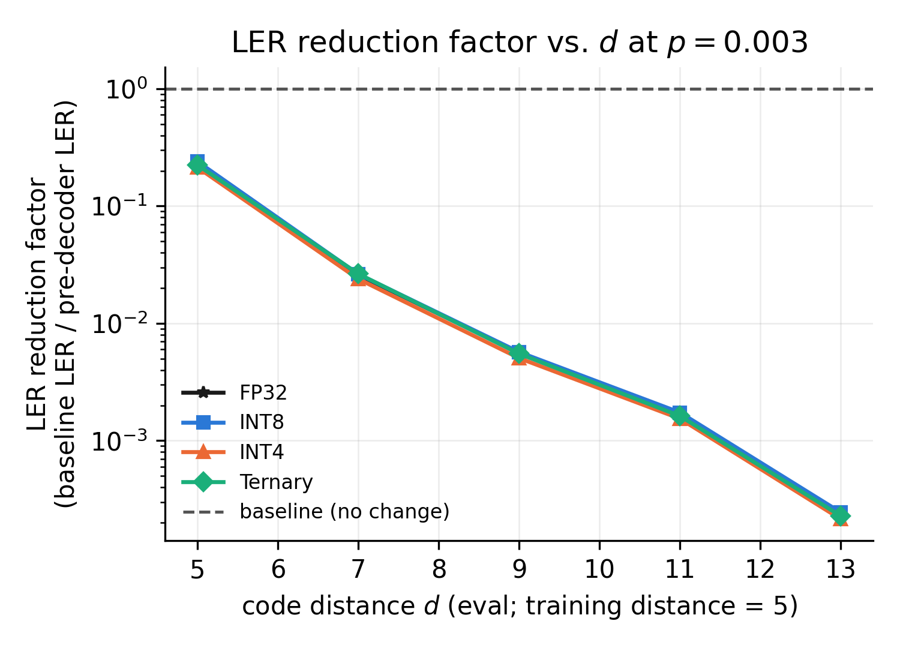
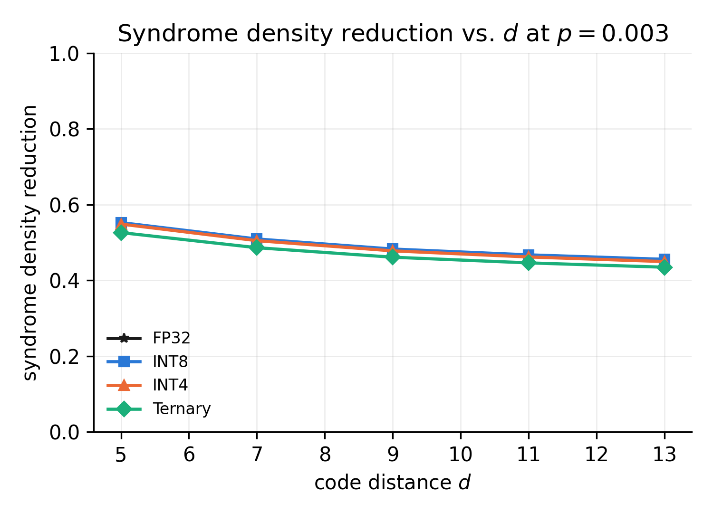
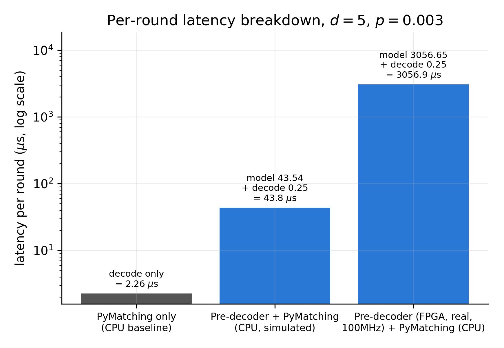
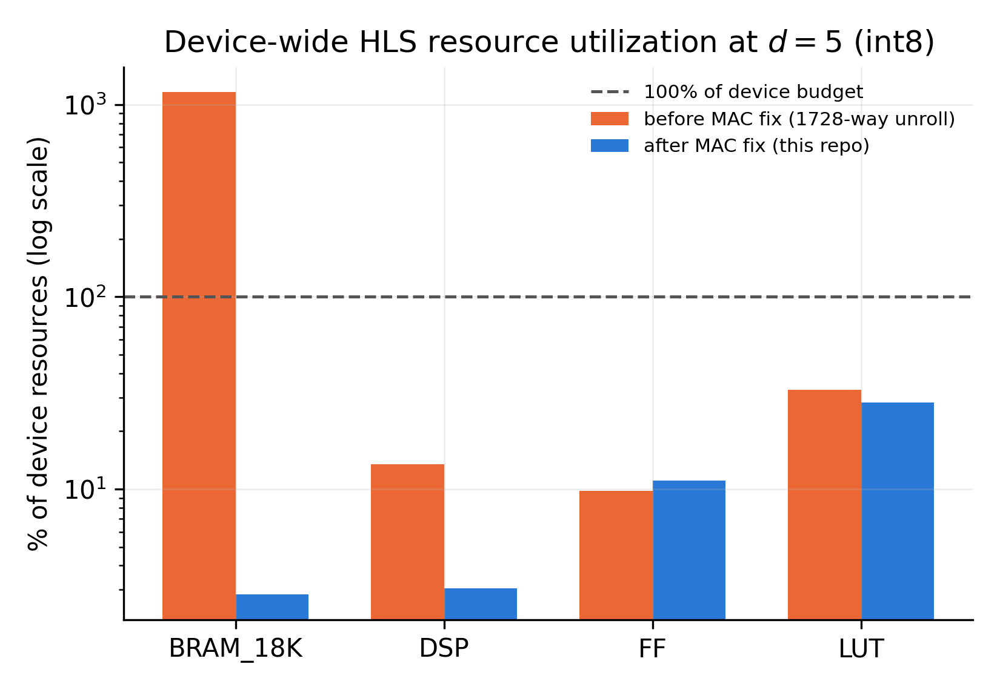
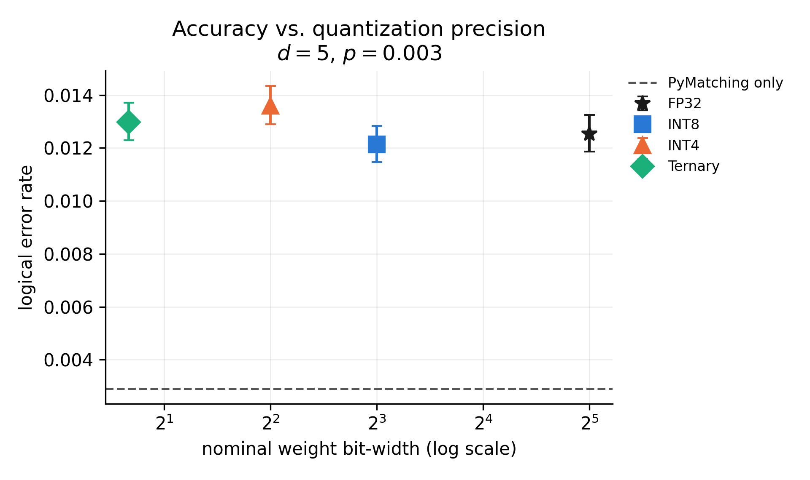

# fpga-neural-predecoder

FPGA reimplementation, in progress, of the neural pre-decoder concept for
surface-code quantum error correction described by NVIDIA's `Ising-Decoding`
work (see `NOTICE`). This is an independent implementation with no NVIDIA
source code; the FPGA microarchitecture, quantization study, and latency
model are original contributions. Author: Nasir Ali, C-DAC Noida.

**Status: Phase 0 (environment and sanity), Phase 1 (QEC data layer),
Phase 3 (quantization), Phase 4 (HLS kernel: csim/csynth/cosim, plus a
real, timing-closed `hw` bitstream built after Phase 5), Phase 5 (host
integration, code written and API-verified but not run against real
hardware), and Phase 6 (benchmarks and figures, R=5 only) done. Phase 2
(pre-decoder model, CPU training) closed for now with an honest,
partially-negative result; R=9 sizing deferred.** The R=5
pre-decoder trains cleanly and its corrections are
architecturally and numerically sound (verified with an oracle test), but
at the default decision threshold it is not yet a net win over PyMatching
alone, and does not yet demonstrate the distance-generalisation property
the method depends on. Several real bugs were found and fixed along the way
(see `docs/DECISIONS.md` for the full trail); the current numbers are
correct and reproducible, just not yet a positive result for the FP32
baseline. The quantization study (Phase 3) is a clean, positive result in
its own right regardless: INT8 and ternary cost essentially nothing
relative to FP32, only INT4 shows a real regression. See
`claude_code_prompt_ising_fpga.md` in the repository root for the full
phased plan this project follows, and `docs/LIMITATIONS.md` /
`docs/DECISIONS.md` for scope reductions and open issues (notably: X/Z
basis only, no "four orientations"; uniform-depolarizing noise only, the
25-parameter noise model is deferred; Phase 2's model quality gap described
above).

## Phase 2 headline numbers (d=5, p=0.003, R=5, threshold=0.5)

| | LER | vs baseline |
|---|---|---|
| PyMatching only (baseline) | 0.00291 | 1x |
| + pre-decoder (FP32) | 0.01292 | 4.4x worse |

Syndrome density reduction is real (55% at d=5), and a decision threshold
around 0.95 gets within noise of baseline (LER 0.00303) while still removing
26% of syndrome density. LER gets worse, not better, at distances beyond the
R=5 training distance. Full numbers: `results/metrics/predecoder_d*.json`.

## Phase 3 headline numbers: quantization (contribution C1, d=5, p=0.003)

| precision | LER | SDR |
|---|---|---|
| FP32 | 0.01292 | 0.550 |
| INT8 | 0.01258 | 0.552 |
| INT4 | 0.01424 | 0.548 |
| Ternary | 0.01303 | 0.526 |

INT8 and ternary are within noise of FP32; INT4 is the only precision with
a consistent regression (~8-10% relative LER at both d=5 and d=7). QAT
fine-tuning: 3 epochs, 500,000 shots/epoch, from the FP32 checkpoint, one
run per precision. HLS weight headers and binary blobs, with SHA-256, are
exported to `hls/weights_{precision}.h` / `.bin`. Full numbers:
`results/metrics/quantization_sweep.json`.

## Phase 4 headline numbers: HLS kernel (INT8, d=5 only, `xcu55c-fsvh2892-2L-e`)

`hls/predecoder_kernel.cpp`: line-buffered 3D conv (not a full-volume
buffer) x2, 1x1x1 output conv, edge-correction + observable-parity stage,
all four DATAFLOW-connected. csim, csynth, and cosim (real RTL simulation,
not just the C model) all pass, cosim bit-exact 10/10 against
`src/model/golden.py`. Real numbers, auto-parsed into
`results/metrics/hls_int8.json` (`scripts/record_hls_metrics.py`), reported
honestly including the parts that are not yet good:

| | original | after BRAM fix (2026-08-19) |
|---|---|---|
| Estimated Fmax | 136.99 MHz | 360.23 MHz |
| Latency (worst case) | 48,077 cycles / 0.481 ms @ 100 MHz | 1,528,325 cycles / 5.094 ms @ ~300 MHz (v++ default clock, not the same target -- see `docs/DECISIONS.md`) |
| DSP / FF / LUT | 13.5% / 9.8% / 32.9% | 3.1% / 11.1% / 28.1% |
| **BRAM_18K** | **46,716 / 4,032 -- 1159%, over 11x budget** | **114 / 4,032 -- 2.8%, under budget** |

This is a first-pass, correctness-prioritized synthesis (two pragma choices
caused multi-hour synthesis runaways before being diagnosed and fixed; see
`docs/DECISIONS.md`), not a resource-optimal one. The original BRAM
overshoot (11x over budget) is now fixed: the dominant driver was a
1728-way fully unrolled MAC loop (`dz,dy,dx,ic` all unrolled for the wide
hidden layer), not the frame buffer. De-unrolling the `ic` dimension to a
27-way spatial unroll plus a serially-pipelined channel reduction cut
BRAM_18K to 2.8% of budget, verified bit-exact via csim before
resynthesizing -- at the cost of ~32x worse latency on top of an already
far-over-target number (per-shot latency remains many orders of magnitude
above the paper's own ~1us aspirational target; no shot-level pipelining
yet). The kernel is scoped to a single fixed distance (d=5), not
runtime-general; see `docs/LIMITATIONS.md`.

**Update, 2026-08-19: a real, timing-closed `.xclbin` was built.**
`v++ -l -t hw` (full place-and-route against the U55C platform shell), in
two attempts: the first, at v++'s own default ~300 MHz target (3h54m),
produced a well-formed but timing-unclosed bitstream (WNS -0.609 ns).
Rebuilding just the link step at an explicit 100 MHz target
(`hls/link_100mhz.cfg`, 2h33m, same `.xo` reused) closed it: **WNS
+0.003 ns, TNS 0.000 ns, 0 of 700,988 endpoints failing**. Verified
well-formed via `xclbinutilinfo` (correct kernel name, platform, HBM port
mapping). Kernel-scoped post-route utilization (excludes the platform
shell): LUT 8.6% / FF 3.4% / BRAM 4.3% / DSP 3.7% of the kernel's user
budget. Real latency at the actual 100 MHz clock: 13.0-15.3 ms/shot,
still roughly 15,000x the paper's ~1us aspirational target. This is the
first result in the project that is simultaneously within budget and
timing-closed; it has not yet been run on the actual card (`run_hw.py`'s
real-hardware path is still an unexercised stub). See
`docs/DECISIONS.md` and `docs/LIMITATIONS.md` for the full trail and
`results/metrics/hw_build_int8.json` for the numbers.

## Phase 5: host integration

`host/host_predecoder.cpp` (XRT C++: HBM bank assignment via
`kernel.group_id()`, a ping-pong/ring buffer of 4 slots for overlap across
shots, per-stage timing) and `host/run_hw.py` (the same design via pyxrt)
are written against the real XRT API -- the C++ host compiles and links
against the real `libxrt_coreutil.so` on this host -- but **have not run
against real hardware**: no xclbin exists (the `hw` build was not
attempted; see Phase 4). `run_hw.py` falls back to the golden model
whenever no xclbin is available (the current, actual state), and labels
every such result `"simulated": true`, loudly, never silently:

```
$ python host/run_hw.py --shots 10000
WARNING: no usable xclbin ... Falling back to the golden model.
RESULTS ARE SIMULATED, NOT FROM REAL HARDWARE.
wrote results/metrics/host_run_d5_p0.003.json (simulated=True)
```

Full numbers: `results/metrics/host_run_d5_p0.003.json`.

## Phase 6: benchmarks and figures (R=5 only; R=9 remains deferred)

`bench/run_phase6_sweep.py` evaluates all four trained R=5 checkpoints
(fp32/int8/int4/ternary) across the full distance x noise-rate grid
(d in {5,7,9,11,13}, p in {0.001,0.002,0.003,0.005}, 80 combinations,
100k shots each), generating any missing PyMatching-only baselines along
the way. `make figures` (`scripts/make_figures.py`) regenerates every
figure below from the committed `results/metrics/*.json` only -- no
network access, no retraining, no re-running HLS/v++.

| | |
|---|---|
|  |  |
|  |  |
|  |  |

The honest finding, stated visually rather than just in prose: every
precision's LER curve sits *above* PyMatching-only across the tested
noise range (Fig 1), and the pre-decoder's relative disadvantage widens
by roughly three orders of magnitude from d=5 to d=13 (Fig 2) -- this
grid confirms, at full scale, the distance-generalisation gap already
found in Phase 2. Syndrome density reduction stays real and substantial
regardless (Fig 3), a separate and still-true claim. Fig 5 is
deliberately not a resource-vs-distance sweep: the kernel was only ever
synthesized at d=5. Full numbers: `results/metrics/phase6_sweep.json`.

## Environment

- venv: Python 3.8.10 (see `docs/DECISIONS.md` for why, not 3.11)
- Dependencies: pinned in `requirements.txt`; exact resolved set in
  `docs/env.lock`
- `stim` is pinned to 1.12.1, not the latest release; see
  `docs/DECISIONS.md`
- `torch` is the CPU-only wheel; `torch.cuda.is_available()` is asserted
  False at every environment check

## Setup

```
make venv
make smoke
```

`make smoke` builds a `d=3, rounds=3` rotated surface-code circuit, samples
1000 shots, decodes with PyMatching, and prints the logical error rate, as a
sanity check that the toolchain works end to end.

## Hardware

Target: Xilinx Alveo U55C. This development host happens to have one
installed with a working XRT stack; see `docs/DECISIONS.md` for the full
inventory. Later phases will state plainly whether a given result came from
C simulation, cosimulation, or an actual on-card `hw` run.

## Limitations

Not yet written; will be added starting in Phase 1 and expanded through the
project (`docs/LIMITATIONS.md`).
